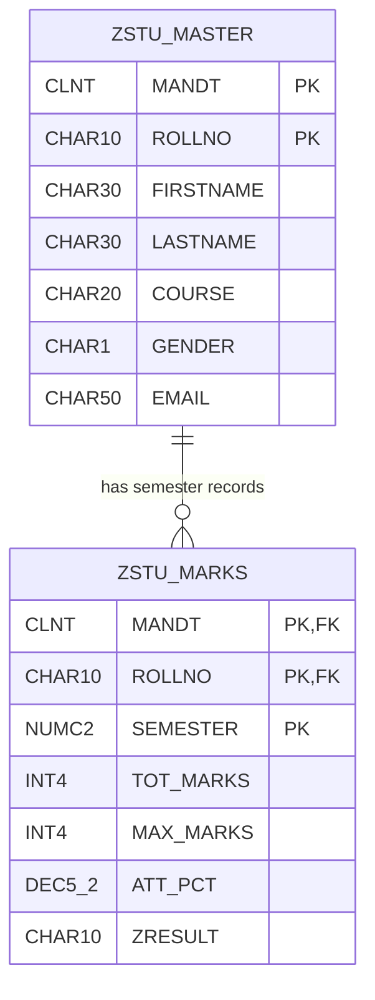

# Entity Relationship Diagram

## Logical relationship

## Key interpretation

- `ZSTU_MASTER` primary key: `MANDT + ROLLNO`.
- `ZSTU_MARKS` primary key: `MANDT + ROLLNO + SEMESTER`.
- `ZSTU_MARKS` references `ZSTU_MASTER` using both client and roll number.
- One student may have zero or many semester rows.

The diagram describes the intended logical model. Verify the actual active SE11 table definitions and foreign-key assignment in the SAP system before treating it as runtime evidence.
